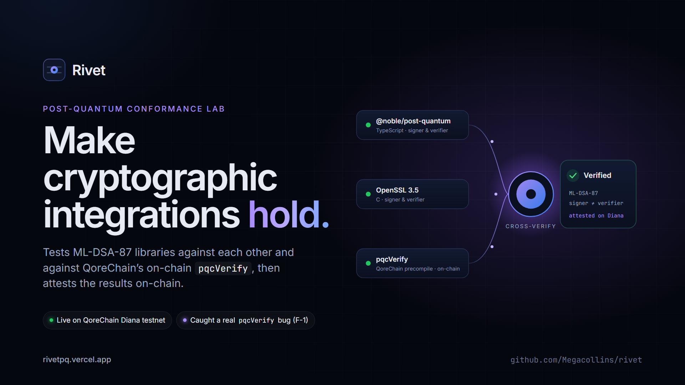

# Rivet: make cryptographic integrations hold



Rivet is a post-quantum interoperability and conformance lab for **ML-DSA-87 on QoreChain**. It signs with independent implementations and verifies every signature with every implementation, including QoreChain's live `pqcVerify` precompile. It then attacks the results and publishes a reproducible report whose ML-DSA-87 attestation is verified **on-chain**.

Built for QoreChain *Build Before Q-Day*, Post-Quantum dApp track, on the **Diana testnet** (EVM chain id 9800).

| | |
|---|---|
| **Live app** | **https://rivetpq.vercel.app** (read-only: runs suites live, verifies attestations in your browser) |
| Source | https://github.com/Megacollins/rivet |
| Registry (Diana) | [`0xbff74b159e7b5988c8a0030c817363074322acd4`](https://explore.qore.network/address/0xbff74b159e7b5988c8a0030c817363074322acd4) (v2). v1, with the F-1 reports: [`0x2afd0bfb2cae5b1f3d0a96265f7b314cb514205c`](https://explore.qore.network/address/0x2afd0bfb2cae5b1f3d0a96265f7b314cb514205c) |
| Operator / attester | `qor1tga4cqmqpnlkvpv8k8ry7cvsjareyspla69l6y` (`0x5A3B5C03600cFF660587B1c64f6190974792403F`) |
| Deployment record | [DEPLOYMENTS.md](DEPLOYMENTS.md) · [deployments/diana.json](deployments/diana.json) |
| Findings | [docs/FINDINGS.md](docs/FINDINGS.md) |
| QCAI audit | [docs/AUDIT.md](docs/AUDIT.md): two-stage QCAI audit. Stage 1 (4 findings) answered with 5 regression tests; stage 2 (3 findings) found one real issue, fixed and redeployed as v2. Reports in `docs/audit/` |

## What it does

- **Test Lab.** @noble/post-quantum and OpenSSL 3.5 derive keys from the same FIPS 204 seeds and sign five vectors, hedged and deterministic. Every signature is checked by both libraries and by `pqcVerify` through `eth_call`, with every call pinned to one Diana block. It also checks determinism: identical keys and identical deterministic signatures across libraries.
- **Attack Lab.** 16 signature attacks plus a control go to every verifier. 8 replay and domain-separation attacks go to the deployed registry: wrong chain id, wrong contract, wrong action, wrong payload, spent nonce, future nonce, expired deadline and tampered results. Each must revert with the contract's own error.
- **Reports.** Self-contained JSON (`rivet.report/v1`) recording versions, vectors, the network and pinned block, and expected/actual/status/evidence per test. A report's identity is `keccak256(RFC 8785 JCS(report))`.
- **On-chain registry.** `RivetRegistry` anchors report hashes and result counts. Every action is authorised by an ML-DSA-87 signature, checked by `pqcVerify`, with domain separation, a nonce and a deadline. Anyone can re-verify an attestation, and the web app does it **from your browser** against the RPC directly.

Unavailable implementations (CIRCL, liboqs, Bouncy Castle) are reported as **unsupported**, never simulated.

## ECDSA sends, ML-DSA admits

On QoreChain an EVM transaction is still signed with **classical ECDSA**. The chain admits it only when the account has **a registered ML-DSA-87 key** and **an open EVM authorisation window**:

1. `MsgRegisterPQCKeyV2` with proof of possession. It must be the account's first transaction and is the only one signed with ECDSA alone.
2. `MsgOpenEVMWindow`, signed hybrid (ECDSA + ML-DSA-87): a block range, a transaction count, a spend cap, and optionally `allowed_targets`.
3. Then ordinary ECDSA-signed EVM transactions are admitted while the window lasts.

Rivet deployed the registry inside an **unscoped** window, because creation requires one. It publishes every report inside a window **scoped to the registry only**. The report attestation is a *separate* ML-DSA-87 signature, checked by the contract through `pqcVerify`. See `engine/scripts/qore.ts` and [DEPLOYMENTS.md](DEPLOYMENTS.md).

## Live results (Diana)

- **Registry v1, report #1 (2026-11-21):** 136 tests; 125 passed, 3 failed (0 critical), 1 skipped, 7 unsupported.
  - The 3 failures are [finding F-1](docs/FINDINGS.md): `pqcVerify` returned `false` for valid signatures over the **empty message**.
- **Registry v1, report #2 (2026-11-24):** 136 tests; **129 passed, 0 failed**, 0 skipped, 7 unsupported.
  - QoreChain fixed F-1 at block 10,654,800. Both reports are attested on chain, before and after the fix.
- Replay suite on the deployed registry: **10/10**.
- **Registry v2 (2026-11-24),** redeployed with the QCAI stage 2 fix ([docs/AUDIT.md](docs/AUDIT.md)): reports #1 and #2, 136 tests each, 0 failed.
- All four reports are published and independently verified, **11/11 checks** each (noble, OpenSSL, `pqcVerify`, `verifyAttestation`, `pqcKeyStatus`, report hash, summary).
- Foundry: **35/35** (including 7 regression tests for the QCAI findings). `pqcVerify` is served in tests by a real ML-DSA-87 verifier over FFI, not a stub.

## Layout

```
contracts/   RivetRegistry.sol, IQorePQC.sol, Foundry tests (FFI → real ML-DSA)
engine/      TypeScript engine (runs natively on Node ≥ 24.7): adapters, suites, reports, chain I/O, CLI
  scripts/   setup-operator.ts · qore.ts (register / window) · deploy.ts
web/         Next.js app: Dashboard, Test Lab, Attack Lab, Reports, Registry, Docs
docs/        FINDINGS.md, AUDIT.md
```

## Run it

Requires Node ≥ 24.7 (native TypeScript, ML-DSA in `node:crypto`), OpenSSL ≥ 3.5 on `PATH` for deterministic OpenSSL signing, and Foundry.

```bash
npm install
cp .env.example .env              # optional: only needed for replay tests / publishing

node engine/src/cli.ts run        # all suites, live on Diana → reports/<id>.json
node engine/src/cli.ts run --offline
node engine/src/cli.ts verify 1 --file reports/<id>.json
npm run dev                       # web app on http://localhost:3480
cd contracts && forge test        # needs node on PATH (FFI)
```

Publishing from the web app requires `RIVET_WEB_OPERATOR=1` and the operator keys in the server environment. Without them the app is read-only. Keys are never returned by any API.

## Security assumptions

- The registry trusts QoreChain's `pqcVerify` and `pqcKeyStatus` precompiles. An unavailable precompile reverts with `PrecompileUnavailable` instead of being treated as success.
- An attester's key must be the exact x/pqc key the chain reports for that account, with possession proven. A deactivated key cannot be revived.
- Signed messages are tagged `RIVET/ATTEST/v1` and bound to the chain id, the contract, the attester, a nonce and a deadline. The tag can't collide with QoreChain's own transaction frames.
- A report hash proves integrity and authorship, not correctness. Anyone can re-run the suites.

## License

[MIT](LICENSE)
